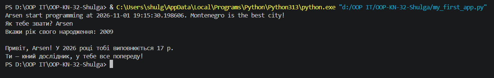
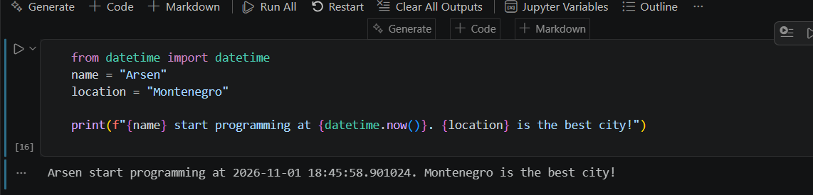

# Звіт до роботи
## Тема: Вступні заняття: налаштування середовища, початок роботи з Python та Markdown.
## Мета: налаштувати середовище роботи у VS Code, створити репозиторій GitHub та налаштувати інтеграцію з ним, написати першу програму на Python і створити звіт із використанням форматування Markdown.
### Виконання роботи
**написали два коди:**
from datetime import datetime
name = "Arsen"
location = "Montenegro"

print(f"{name} start programming at {datetime.now()}. {location} is the best city!")

from datetime import datetime

1. Запитуємо дані у користувача
name = input("Як тебе звати? ")
birth_year = int(input("Вкажи рік свого народження: "))

2. Розраховуємо вік на основі поточного року
current_year = datetime.now().year
age = current_year - birth_year

3. Логіка: реакція програми залежно від віку
if age < 18:
    status = "юний дослідник, у тебе все попереду!"
elif age < 60:
    status = "у самому розквіті сил та кар'єри!"
else:
    status = "досвідчений мудрець!"

4. Виводимо персоналізоване привітання
print(f"\nПривіт, {name}! У {current_year} році тобі виповнюється {age} р.")
print(f"Ти — {status}")
**Результати виконання:**

## Висновок
- В роботі написаний код та використаний Markdown
- Так досягнуто
- Отримав розуміння Markdown, користування пайтоном та ШІ
- Так вдалося
- Так
- Трохи тупив з тим як закомітити але розібрався
- Так все подобається, все супер!
- Навіть немаю що сказати все детально написано
